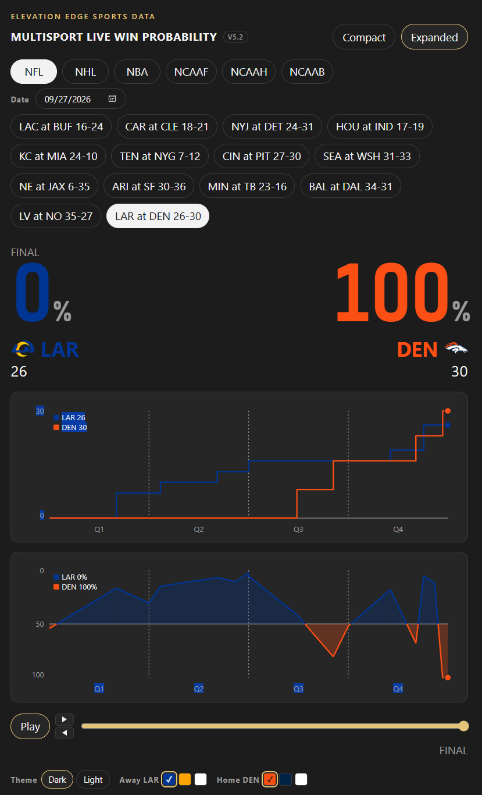

# Multisport live win probability

Unofficial fan project. Not affiliated with any sport or league.

Win probability for NFL, NHL, NBA, NCAAF, NCAAH, and NCAAB. 




## Setup

```powershell
python -m venv .venv
.\.venv\Scripts\Activate.ps1
python -m pip install -e ".[dev]"
```

## Serve

```powershell
python -m live_win_prob serve
```

The live site is on GitHub Pages. Select any date to load that day’s slate and chart any game (scores and win probability).

For local development, run `python -m live_win_prob serve` and open http://127.0.0.1:8765.

## Pregame prior

A home American moneyline is the pregame prior when that price is present (`prior_source` `moneyline`). For NFL, NHL, and NBA, a missing moneyline uses the static Elo prior in `data/elo_snapshot.json` (`elo`). The sport's `home_advantage` in that file is added to the home rating, and no extra boost is applied. A caller-supplied prior is next (`passed`). The last fallback is 0.5 (`default`). College games do not use the Elo file. This package does not import the playoff-lab package. Refresh the snapshot by copying `outputs/elo_snapshot.json` from that repo onto `data/elo_snapshot.json`.